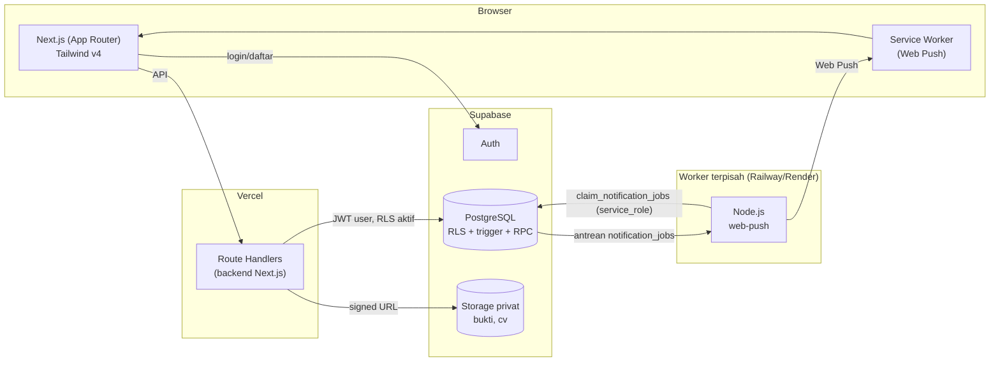
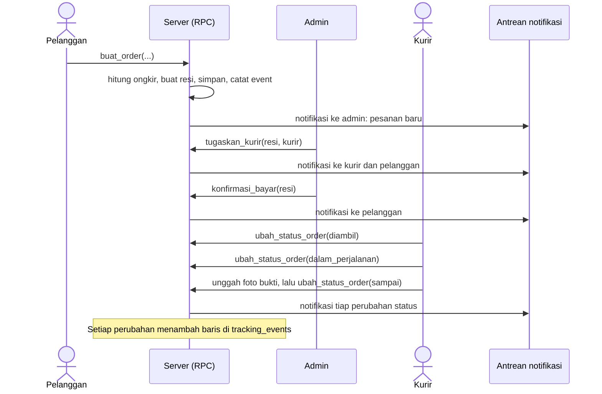
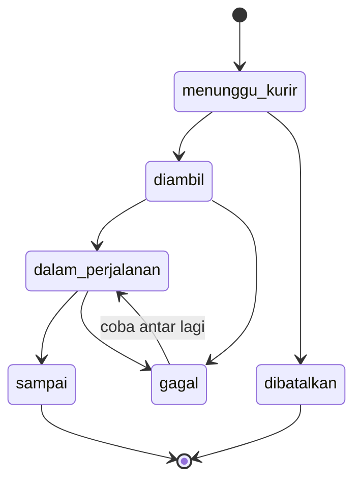
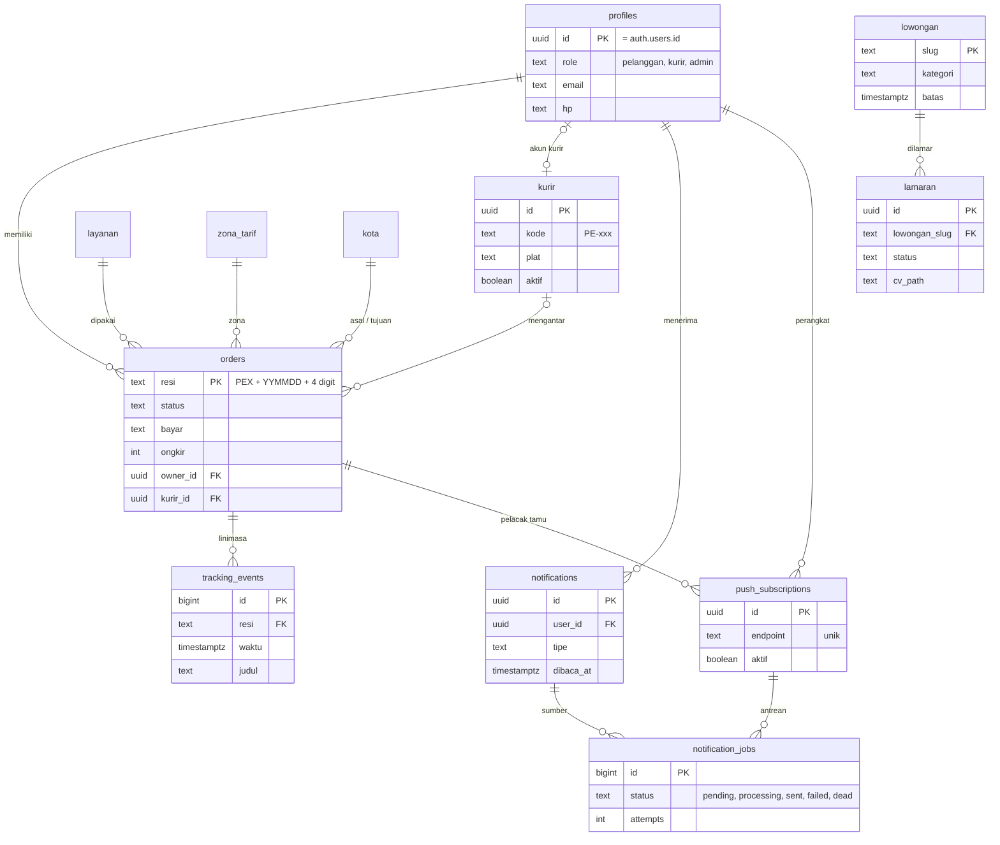
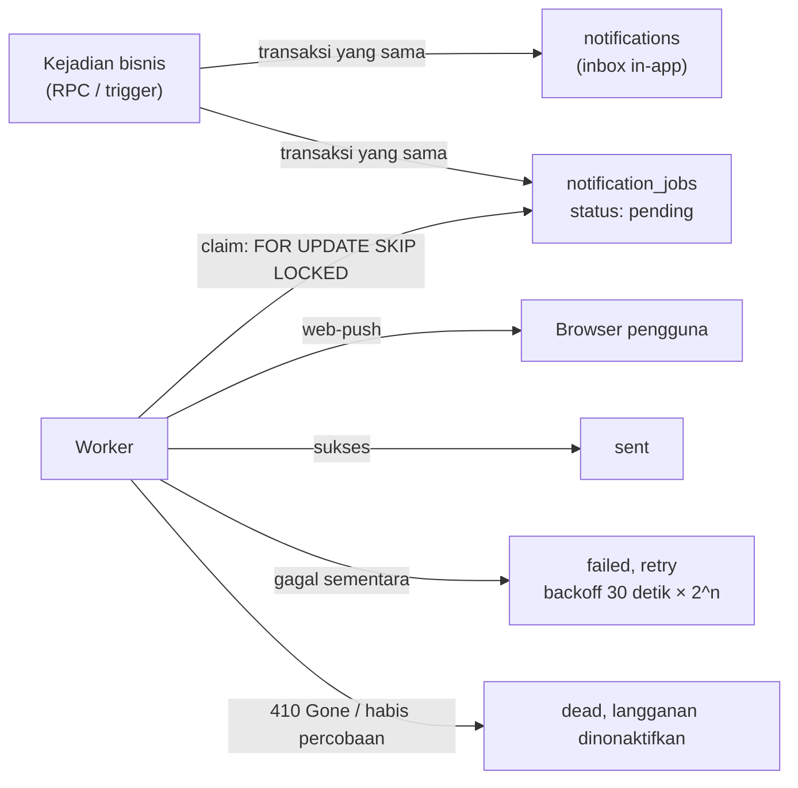

<div align="center">


# Phelya Express

**Aplikasi web pengiriman paket untuk tiga peran: pelanggan, kurir, dan admin.**
Kirim, lacak, antar, dan kelola paket dalam satu platform dengan tarif transparan dan notifikasi langsung.

`Next.js` · `JavaScript` · `Tailwind CSS v4` · `Supabase (PostgreSQL)` · `Web Push`

</div>

---

## Daftar isi

1. [Status proyek](#status-proyek)
2. [Gambaran umum](#gambaran-umum)
3. [Arsitektur](#arsitektur)
4. [Alur kerja sistem](#alur-kerja-sistem)
5. [Aturan status paket](#aturan-status-paket)
6. [Perhitungan ongkir](#perhitungan-ongkir)
7. [Desain database](#desain-database)
8. [Keamanan dan validasi berlapis](#keamanan-dan-validasi-berlapis)
9. [Sistem notifikasi](#sistem-notifikasi)
10. [Struktur folder](#struktur-folder)
11. [Menjalankan proyek](#menjalankan-proyek)
12. [Akun uji](#akun-uji)
13. [Roadmap](#roadmap)

---

## Status proyek

| Lapisan | Status | Keterangan |
|---|---|---|
| Frontend (UI semua halaman, light/dark mode) | Selesai | Semua halaman memakai data nyata dari Supabase |
| Database Supabase (skema, constraint, RLS, Storage, fungsi bisnis, seed) | Selesai | Ada di `supabase/`, sudah diuji |
| Menyambungkan frontend ke Supabase (Auth + API) | Selesai | Login sungguhan, rute dilindungi per peran, semua data lewat `/api/*` |
| Notifikasi (lonceng in-app + Web Push + worker) | Belum | Tabel dan antreannya sudah siap di database |
| Label resi PDF dengan QR | Belum | |
| Deploy online (Vercel + worker) | Belum | |

> Browser hanya berbicara dengan Supabase Auth untuk masuk dan keluar. Semua data dibaca dan ditulis lewat Route Handlers `/api/*` yang memakai sesi pengguna, sehingga RLS tetap berlaku. Aturan bisnis (ongkir, nomor resi, transisi status, hak akses) tetap dijalankan di database; server hanya memetakan galat ke pesan yang ramah.

## Gambaran umum

| Peran | Yang bisa dilakukan |
|---|---|
| **Tamu** | Melihat beranda dan layanan, menghitung tarif, melacak resi di peta, melihat lowongan dan melamar lewat form karier |
| **Pelanggan** | Membuat pesanan, melihat dan membatalkan pesanan miliknya (selama masih menunggu kurir), melacak paket, mengelola profil |
| **Kurir** | Melihat tugas yang ditugaskan, memperbarui status pengantaran, mengunggah foto bukti serah terima |
| **Admin** | Melihat semua pesanan, menugaskan kurir, mengonfirmasi pembayaran, mengelola kurir, tarif dan zona, pelanggan, serta lowongan dan lamaran |

**Layanan pengiriman:** Reguler, Kilat, Same Day (khusus Zona 1 dan 2), dan Kargo (minimal 10 kg).

## Arsitektur



**Keputusan arsitektur utama**

- **Satu sumber kebenaran di database.** Aturan transisi status, hitung ongkir, pembuatan resi, dan otorisasi per peran dijalankan di PostgreSQL (fungsi dan trigger). Backend Next.js dan frontend hanya memanggilnya, jadi tidak ada aturan yang bisa dilewati dengan menembak API langsung.
- **Backend = Route Handlers Next.js.** Tidak memakai PostgREST langsung dari browser untuk operasi tulis. Tabel inti (`orders`) tidak bisa di-`INSERT`/`UPDATE` langsung oleh client, hanya lewat fungsi.
- **Antrean notifikasi di Postgres (pola outbox).** Job notifikasi dibuat dalam transaksi yang sama dengan perubahan status. Artinya status berubah selalu berpasangan dengan notifikasi yang antre, dan kegagalan push tidak membatalkan transaksi bisnis.
- **Worker terpisah.** Web Push butuh proses yang hidup terus, yang tidak cocok dijalankan di Vercel, sehingga worker Node kecil dijalankan di Railway atau Render.

## Alur kerja sistem

### 1. Siklus hidup sebuah pesanan



### 2. Pelacakan resi oleh tamu

Tamu memasukkan nomor resi di halaman `/lacak`. Server memanggil `lacak_resi`, yang hanya mengembalikan informasi non-sensitif: status, layanan, kota asal dan tujuan, estimasi, nama dan kode kurir, serta linimasa. **Alamat lengkap dan nomor HP tidak ikut dikirim.** Posisi paket di peta (Leaflet) adalah simulasi berdasarkan status dan jalur dummy antar kota.

### 3. Lamaran karier

Pelamar mengisi form dan mengunggah CV (PDF, maksimal 2 MB). Berkas disimpan di bucket privat `cv` oleh server, lalu satu baris `lamaran` dibuat. Trigger otomatis memberi notifikasi ke semua admin. Hanya admin yang dapat membaca CV, lewat signed URL.

## Aturan status paket



| Aturan | Dijaga oleh |
|---|---|
| Hanya transisi di atas yang sah, status `sampai` dan `dibatalkan` bersifat final | Trigger `orders_guard`, berlaku untuk siapa pun termasuk `service_role` |
| Pembatalan hanya oleh pemilik atau admin, dan hanya saat `menunggu_kurir` | Fungsi `ubah_status_order` |
| Status lain hanya oleh kurir yang ditugaskan di pesanan itu, atau admin | Fungsi `ubah_status_order` |
| `gagal` wajib punya alasan | CHECK constraint dan fungsi |
| `sampai` wajib punya foto bukti di Storage dengan path `<resi>/...` | Fungsi `ubah_status_order` |
| Pesanan yang sudah berstatus lanjut wajib punya kurir | CHECK constraint |

Logika yang sama ada di sisi frontend (`src/lib/status.js`) hanya untuk menampilkan tombol dan pesan yang sesuai. Keputusan akhir ada di database.

## Perhitungan ongkir

```
jarak       = haversine(koordinat kota asal, koordinat kota tujuan)   (km, dibulatkan)
zona        = zona pertama yang max_km >= jarak
tertagih    = ceil(berat)                                             (kg)
ongkir      = round( tertagih × tarif_per_kg(zona) × pengali_layanan / 500 ) × 500
```

| Zona | Jarak maks. | Tarif / kg |
|---|---|---|
| Zona 1, dalam kota | 40 km | Rp 8.000 |
| Zona 2, antar kota dekat | 250 km | Rp 11.000 |
| Zona 3, antar provinsi | 700 km | Rp 15.000 |
| Zona 4, jarak jauh | tanpa batas | Rp 21.000 |

| Layanan | Pengali | Ketentuan |
|---|---|---|
| Reguler | 1,0 | |
| Kilat | 1,6 | |
| Same Day | 2,4 | Hanya Zona 1 dan 2 |
| Kargo | 0,7 | Minimal 10 kg |

Berat maksimal 100 kg per paket. Contoh: Semarang ke Jakarta, 2 kg, Reguler menghasilkan **Rp 30.000**. Perhitungan dilakukan oleh fungsi `hitung_ongkir` di database, dan tarif serta zona dapat diubah admin tanpa mengubah kode.

## Desain database



**13 tabel:** `kota`, `zona_tarif`, `layanan`, `profiles`, `kurir`, `orders`, `tracking_events`, `lowongan`, `lamaran`, `notifications`, `push_subscriptions`, `notification_jobs`, dan sekuens `resi_seq` untuk nomor resi.

**Fungsi (RPC) yang dipanggil aplikasi**

| Fungsi | Siapa | Fungsi |
|---|---|---|
| `hitung_ongkir` | semua | Menghitung zona, jarak, ongkir, dan estimasi |
| `lacak_resi` | semua | Data pelacakan publik tanpa data pribadi |
| `buat_order` | pelanggan | Membuat pesanan, menghitung ongkir di server, membuat resi |
| `ubah_status_order` | pemilik, kurir, admin | Mengubah status sesuai aturan dan hak akses |
| `tugaskan_kurir` | admin | Menugaskan kurir aktif ke pesanan |
| `konfirmasi_bayar` | admin | Menandai pembayaran lunas |
| `claim_notification_jobs`, `complete_notification_job`, `fail_notification_job` | worker (`service_role`) | Mengambil dan menutup job notifikasi |

## Keamanan dan validasi berlapis

Validasi dilakukan di tiga lapisan, dan lapisan lebih dalam tidak mempercayai lapisan di atasnya.

| Lapisan | Contoh |
|---|---|
| **Frontend** | Pesan galat langsung untuk pengguna, batas ukuran dan tipe file, format HP |
| **Server (fungsi dan Route Handler)** | Cek login, cek peran dan kepemilikan, ongkir dihitung ulang, resi dibuat server |
| **Database** | CHECK, UNIQUE, foreign key, trigger transisi status, RLS |

**Matriks akses (RLS)**

| Data | Tamu | Pelanggan | Kurir | Admin |
|---|---|---|---|---|
| Kota, zona, layanan, lowongan | baca | baca | baca | kelola |
| Pesanan | tidak ada | miliknya | yang ditugaskan | semua |
| Riwayat pelacakan | lewat `lacak_resi` | pesanan miliknya | pesanan tugasnya | semua |
| Profil | tidak ada | miliknya | miliknya | semua |
| Lamaran dan CV | tidak ada | tidak ada | tidak ada | baca dan ubah status |
| Notifikasi dan langganan push | tidak ada | miliknya | miliknya | miliknya |
| Antrean `notification_jobs` | tidak ada | tidak ada | tidak ada | tidak ada (hanya `service_role`) |

**Hal penting lainnya**

- `role` tidak bisa diubah dari client. Akun baru selalu `pelanggan`, dan role tidak pernah dibaca dari metadata yang dikirim pengguna.
- Mengganti nomor resi milik orang lain di URL hanya mengembalikan nol baris, tidak ada kebocoran data (IDOR).
- Semua bucket Storage privat dan dibatasi ukuran serta tipe berkas: `bukti` (JPG/PNG/WebP) dan `cv` (PDF), masing-masing maksimal 2 MB.
- Fungsi `SECURITY DEFINER` memakai `search_path` kosong dan hak `EXECUTE` dicabut dari `public`, lalu diberikan hanya ke peran yang perlu.
- Seluruh pengujian (62 skenario: RLS per peran, constraint, trigger, alur status penuh, dan antrean) dijalankan di dalam transaksi yang di-rollback.

## Sistem notifikasi

Peristiwa yang memicu notifikasi:

| Kejadian | Penerima |
|---|---|
| Pesanan baru | Admin |
| Kurir ditugaskan | Kurir dan pelanggan |
| Status paket berubah | Pelanggan (dan pelacak tamu), admin bila gagal atau dibatalkan |
| Pembayaran dikonfirmasi | Pelanggan |
| Lamaran baru | Admin |

**Alur pengirimannya**



- **Anti-ganda:** kombinasi `(subscription_id, dedup_key)` unik, jadi kejadian yang sama tidak mengirim dua kali.
- **Aman untuk banyak worker:** `SKIP LOCKED` mencegah dua worker mengambil job yang sama. Job yang terkunci lebih dari 5 menit (worker mati) diambil ulang.
- **Rencana tampilan:** ikon lonceng dengan badge belum dibaca di header ketiga dashboard, dropdown inbox, dan toggle "Notifikasi push" di halaman profil. Pelacak tamu tetap mengaktifkan push dari halaman lacak resi.

## Struktur folder

```
phelya-express/
├─ public/
│  ├─ brand/                 logo
│  └─ mascot/                maskot Phely (burung merpati, latar transparan)
├─ src/
│  ├─ app/
│  │  ├─ (site)/             beranda, layanan, cek tarif, lacak, karier, bantuan
│  │  ├─ (auth)/             masuk, daftar
│  │  ├─ dashboard/          area pelanggan (buat pesanan, pesanan, profil)
│  │  ├─ kurir/              area kurir (tugas, riwayat, profil)
│  │  └─ admin/              area admin (order, kurir, pelanggan, pembayaran, tarif, karier)
│  ├─ components/
│  │  ├─ ui/                 komponen dasar (button, card, field, badge, toast, tema)
│  │  ├─ dashboard/          shell, tabel, grafik, drawer pesanan
│  │  ├─ tracking/           peta, linimasa, form resi
│  │  ├─ career/             daftar lowongan dan form lamaran
│  │  ├─ sections/ layout/ auth/
│  │  ├─ order-store.js      store klien: memuat /api/bootstrap, aksi tulis lewat /api/*
│  │  └─ session-guard.js    mengakhiri sesi bila "Ingat saya" tidak dicentang
│  ├─ app/api/               Route Handlers: bootstrap, me, orders, tarif, zona, pelanggan, lamaran, lowongan
│  ├─ proxy.js               menyegarkan sesi dan melindungi /dashboard, /kurir, /admin per peran
│  ├─ lib/
│  │  ├─ status.js           aturan status (cermin dari database)
│  │  ├─ tariff.js           ongkir (cermin dari hitung_ongkir)
│  │  ├─ supabase/           client browser dan server (sesi cookie, client anon)
│  │  ├─ api/                guard (peran, galat) dan pemeta data ke bentuk UI
│  │  ├─ lacak.js            pelacakan publik via RPC lacak_resi
│  │  ├─ route.js            jalur peta dummy
│  │  └─ format.js           format rupiah dan tanggal
│  └─ data/akun-uji.js       akun uji untuk tombol "Isi otomatis" di halaman masuk
└─ supabase/
   ├─ migrations/            001 skema, 002 fungsi dan trigger, 003 RLS dan Storage, 004 pemisahan policy admin, 005 integrasi frontend (HP saat daftar, penyamaran data pelacakan, lamaran tanpa service_role)
   └─ seed.sql               data dummy dan akun uji
```

## Menjalankan proyek

**Frontend**

```bash
npm install
npm run dev      # http://localhost:3000
npm run lint
npm run build
```

**Database (project Supabase baru)**

1. Jalankan file di `supabase/migrations/` berurutan (001 sampai 005), lewat SQL Editor atau `supabase db push`.
2. Jalankan `supabase/seed.sql` untuk data dummy dan akun uji.
3. Nonaktifkan registrasi yang tidak perlu dan aktifkan **Leaked Password Protection** di Authentication.

**Variabel lingkungan** (salin `.env.example` menjadi `.env.local`)

| Variabel | Dipakai oleh | Catatan |
|---|---|---|
| `NEXT_PUBLIC_SUPABASE_URL` | browser, server | |
| `NEXT_PUBLIC_SUPABASE_PUBLISHABLE_KEY` | browser, server | kunci publik (aman di browser, dibatasi RLS) |
| `SUPABASE_SERVICE_ROLE_KEY` | hanya worker notifikasi nanti | **Rahasia.** Aplikasi web tidak memerlukannya. Jangan masukkan ke browser atau repo |
| `NEXT_PUBLIC_VAPID_PUBLIC_KEY`, `VAPID_PRIVATE_KEY` | Web Push (tahap berikutnya) | dibuat dengan `npx web-push generate-vapid-keys` |

## Akun uji

Semua data di bawah adalah **simulasi** (identitas fiktif). Kata sandi sama untuk semua akun.

| Peran | Email | Kata sandi |
|---|---|---|
| Pelanggan | `pelanggan@phelya.id` | `Phelya123!` |
| Kurir | `kurir@phelya.id` | `Phelya123!` |
| Admin | `admin@phelya.id` | `Phelya123!` |

Resi contoh: `PEX2610310001` (dalam perjalanan), `PEX2610309887` (sampai), `PEX2610308333` (gagal kirim).

> Akun uji ini hanya untuk pengujian. Ganti atau hapus sebelum dipakai di lingkungan sungguhan.

## Roadmap

- [x] Frontend lengkap: tiga dashboard, pelacakan dengan peta, karier, light dan dark mode, bahasa Indonesia
- [x] Database: skema, constraint, trigger status, RLS, Storage privat, fungsi bisnis, seed, pengujian
- [x] Sambungkan frontend ke Supabase: Auth, proteksi rute per peran, `order-store` memakai API server
- [x] Unggah foto bukti dan CV ke Storage lewat server (cek tipe berkas asli dan ukuran maksimal 2 MB)
- [ ] Notifikasi: lonceng in-app, Web Push, dan worker pengirim
- [ ] Label resi PDF dengan QR
- [ ] Deploy online (Vercel untuk aplikasi, Railway atau Render untuk worker)

---

<div align="center">
<sub>Phelya Express · proyek akhir mata kuliah pengembangan web</sub>
</div>
